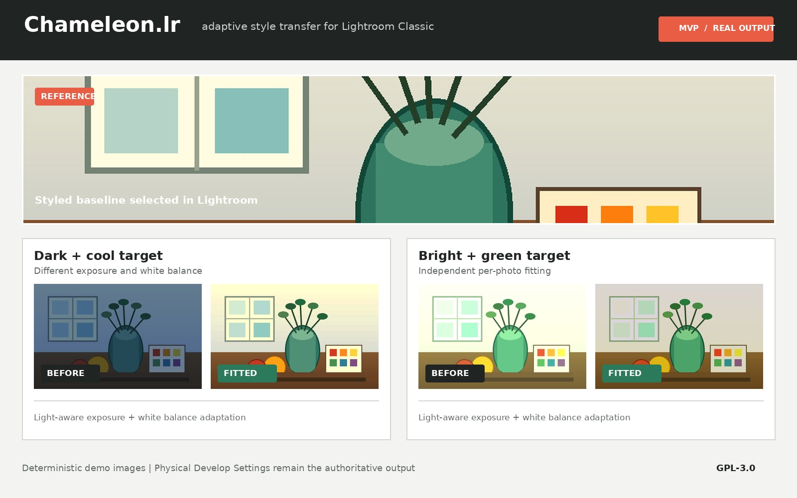
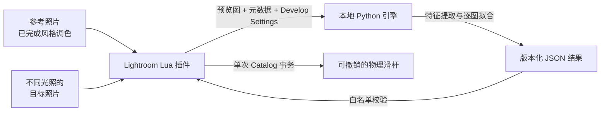

<div align="center">

# Chameleon.lr

**面向 Lightroom Classic 的自适应、非破坏性智能调色插件**

[](https://github.com/jwj1342/Chameleon.lr/actions/workflows/ci.yml)
[](docs/mvp.md)
[](backend/pyproject.toml)
[](plugin/Chameleon.lrplugin/Info.lua)
[](LICENSE)

[快速体验](#快速体验) · [安装插件](#在-lightroom-中使用) · [项目文档](docs/README.md) · [研发路线](docs/roadmap.md) · [参与贡献](CONTRIBUTING.md)

</div>



Chameleon.lr 解决固定 Preset 在曝光、白平衡和环境色变化后失去一致性的问题。摄影师先在
一张基准照片上完成风格调色，插件再分析参考图与目标图的渲染预览，为每张目标照片独立
推导 Exposure、White Balance、基础色调、HSL、Tone Curve 和 Color Grading 等
Lightroom **物理滑杆参数**。

原始照片始终不被修改。所有结果通过 Lightroom Develop Settings 写入 Catalog，并保留
历史记录和撤销能力。

> [!IMPORTANT]
> 当前版本是可运行、可测试的 **MVP / 研究原型**。仓库已经打通 Lightroom Lua 插件、
> Python 算法引擎、版本化协议、Mock 测试、打包与 Release 自动化；算法目前是可解释的
> 全局统计基线，还不是经过真实摄影数据训练和验证的生产级模型。

## 它如何工作



当前默认采用短生命周期 CLI 传输：实现简单、易调试，也不会把照片上传到云端。协议边界
已经独立，未来可以在不改动算法核心的前提下切换到本地 Socket 服务。

## 当前能力

| 模块 | 已实现 | 当前边界 |
| --- | --- | --- |
| Lightroom 插件 | 选图、元数据与 Develop Settings 读取、异步 JPEG 预览、结果回写 | UI 与真实 Catalog 交互仍需 Lightroom 实机验收 |
| 算法引擎 | 亮度直方图/分位数、饱和度、RGB 色偏、曝光和白平衡自适应 | 基于全局统计，不理解主体、局部光照或场景语义 |
| 风格迁移 | 基础色调、HSL、Tone Curve、Color Grading | 仅允许明确白名单中的滑杆；不迁移裁剪、蒙版和修复 |
| 安全与恢复 | 单次 Catalog 写事务、历史记录、部分失败诊断、可撤销 | 请先在副本 Catalog 和非关键照片上试用 |
| 工程化 | Windows/macOS/Linux Python CI、Lua Mock、JSON Schema、跨平台打包 | 发布二进制尚未签名或 notarize |

更精确的范围和非目标见[项目定义](docs/project-definition.md)，MVP 验收标准见
[MVP 说明](docs/mvp.md)。

## 快速体验

不安装 Lightroom 也可以运行完整算法链路。后端要求 Python 3.10+：

```text
# macOS / Linux
python3 -m venv .venv
source .venv/bin/activate

# Windows PowerShell
py -3 -m venv .venv
.\.venv\Scripts\Activate.ps1
```

激活环境后，各平台使用同一组不依赖 Make 或 POSIX Shell 的命令：

```bash
python -m pip install -e './backend[dev]'
python scripts/dev.py doctor
python scripts/dev.py test-python
python scripts/dev.py demo
```

在浏览器中打开 `demo/output/index.html`。报告包含参考图、两种不同环境光输入、拟合预览、
滑杆差异、特征收敛指标，以及实际传输的 `request.json` / `response.json`。

> [!NOTE]
> Demo 中的拟合 JPEG 只是近似可视化。Pillow 无法复现 Adobe Camera Raw 渲染管线；
> JSON 中的 Develop Settings 才是插件的权威输出。

常用质量检查：

```bash
python scripts/dev.py test
python scripts/dev.py lint
```

完整检查需要 Lua 5.1 与 Luacheck。工具不在默认名称或 PATH 中时，可设置
`CHAMELEON_LUA`、`CHAMELEON_LUAC` 和 `CHAMELEON_LUACHECK`。Makefile 只是
macOS/Linux/HPC 上的快捷方式，不是项目依赖。详见[开发指南](docs/development.md)和
[跨平台说明](docs/portability.md)。

## 在 Lightroom 中使用

### 从源码加载（当前推荐）

1. 在 Lightroom Classic 中打开 `File > Plug-in Manager`。
2. 点击 `Add`，选择本仓库的 `plugin/Chameleon.lrplugin`。
3. 在插件配置中选择 `Python script (development)`。
4. 设置 Python 与 `backend/chameleon_cli.py` 的绝对路径，然后点击 `Test Engine`。

### 执行一次风格迁移

1. 在 Library 中多选照片，将已经完成调色的照片设为活动照片。
2. 运行 `Library > Plug-in Extras > Apply Adaptive Style...`。
3. 检查参考照片、目标数量、强度与自适应选项后执行。
4. 在 Lightroom History 中检查结果；需要时可直接撤销。

构建独立引擎和插件 ZIP：

```bash
python scripts/dev.py bootstrap
python scripts/dev.py package
```

版本化产物位于 `dist/`。带 `vX.Y.Z` 的 Git tag 会触发 macOS（Intel/Apple Silicon）和
Windows 构建，并发布校验和；详见[CI/CD 与发布](docs/ci-cd.md)。

## 仓库结构

```text
plugin/Chameleon.lrplugin/  Lightroom Classic Lua 插件
backend/                    Python 特征提取与拟合引擎
protocol/                   请求/响应 JSON Schema
examples/                   协议样例
demo/                       可重复生成的端到端演示
tests/lua/                  Lightroom SDK Mock 与 Lua 测试
scripts/                    版本、打包和文档维护工具
docs/                       产品、架构、算法与开发文档
.github/                    CI/CD 与协作模板
```

## 文档

新贡献者建议从[文档导航](docs/README.md)开始：

| 主题 | 文档 |
| --- | --- |
| 为什么做、为谁做、做与不做什么 | [项目定义](docs/project-definition.md) |
| 模块职责与端到端数据流 | [系统架构](docs/architecture.md) |
| 请求、响应、版本与兼容策略 | [JSON 协议](docs/protocol.md) |
| 特征、拟合公式、边界与演进方向 | [算法说明](docs/algorithm.md) |
| 本地环境、测试、调试与常见变更 | [开发指南](docs/development.md) |
| Windows、macOS、Linux 与 HPC 差异 | [跨平台说明](docs/portability.md) |
| Lightroom SDK 约束与实机调试 | [Lightroom 开发](docs/lightroom-development.md) |
| 自动检查、打包与发布流程 | [CI/CD](docs/ci-cd.md) |
| 近期优先级与生产化条件 | [研发路线](docs/roadmap.md) |

## 参与项目

提交代码前请阅读[贡献指南](CONTRIBUTING.md)，并确保相关测试、协议样例和文档随行为变更
一起更新。Bug、功能建议与文档问题可以使用 GitHub Issue 模板；一般使用问题见
[支持指南](SUPPORT.md)，安全问题请按[安全策略](SECURITY.md)私下报告。

项目遵循[社区行为准则](CODE_OF_CONDUCT.md)。版本变化记录在 [CHANGELOG](CHANGELOG.md)。

## 许可证与声明

本项目采用 [GPL-3.0](LICENSE) 许可证。

Chameleon.lr 是独立开源项目，不隶属于 Adobe，也未获得 Adobe 官方认可。Adobe、
Lightroom 和 Lightroom Classic 是其各自所有者的商标。
